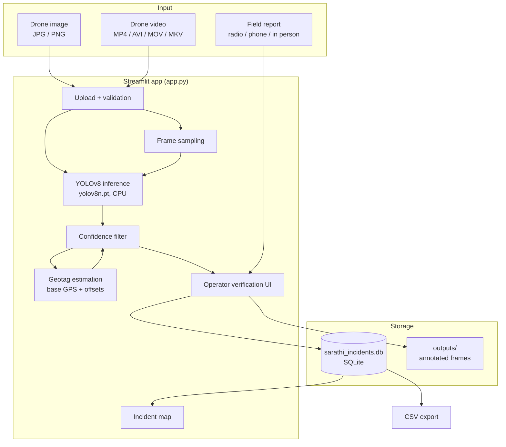
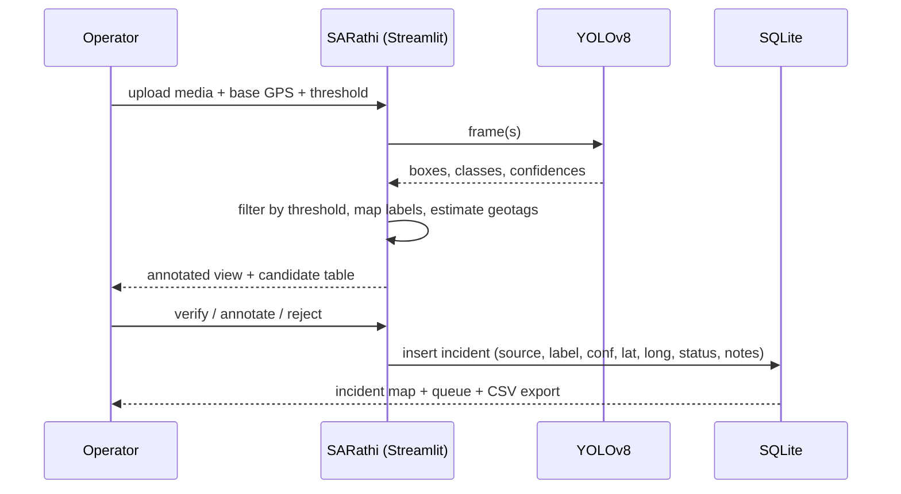

<div align="center">

# 🚁 SARathi

### Offline Search-and-Rescue Coordination Prototype

**Computer-vision triage for disaster response — detect, geotag, verify, and coordinate, on a laptop, with no internet connection.**

[](https://www.python.org/)
[](https://streamlit.io/)
[](https://docs.ultralytics.com/)
[](https://opencv.org/)
[](https://www.sqlite.org/)
[](#scope-limitations--ethics)
[](#license)

</div>

---

> [!WARNING]
> **Prototype notice:** SARathi is an academic MVP. It is **not** a certified emergency-response product.
> AI detections must be verified by a human operator before any action. Do not use this software for
> real-life rescue operations.

---

## Table of contents

- [Why this exists](#why-this-exists)
- [What it does](#what-it-does)
- [Screenshots](#screenshots)
- [Architecture](#architecture)
- [How the detection pipeline works](#how-the-detection-pipeline-works)
- [Repository structure](#repository-structure)
- [Data model](#data-model)
- [Getting started](#getting-started)
- [Using the app, tab by tab](#using-the-app-tab-by-tab)
- [Configuration](#configuration)
- [Running offline](#running-offline)
- [Deploying](#deploying)
- [Design decisions](#design-decisions)
- [Scope, limitations & ethics](#scope-limitations--ethics)
- [Roadmap](#roadmap)
- [Troubleshooting](#troubleshooting)
- [Contributing](#contributing)
- [License](#license)
- [Acknowledgements](#acknowledgements)

---

<a id="why-this-exists"></a>

## 🎯 Why this exists

During floods, landslides and other disasters, the first hour of information is the most valuable — and the
least available. Comms infrastructure is usually the first thing to fail, so responders are left with:

- drone and phone footage that nobody has time to watch frame by frame,
- coordinates shouted over a radio into a notebook,
- several agencies triaging the same area with no shared picture of what has already been checked.

**SARathi** is a small, offline-first coordination surface for exactly that gap. A field operator drops in a
drone image or video, the app proposes candidate objects (people, vehicles/obstructions), estimates where
they are, and queues them for human verification — all on a single machine, with the model and the database
living next to the app. Nothing leaves the laptop.

<a id="what-it-does"></a>

## ✨ What it does

| Capability | Description |
|---|---|
| 🖼️ **AI-assisted detection** | YOLOv8 object detection on uploaded drone/phone **images or videos**, with an adjustable confidence threshold and a side-by-side original vs. annotated view. |
| 📍 **Approximate geotagging** | Each detection gets a latitude/longitude pin estimated around the operator-supplied base GPS point, so candidates land on a map instead of only in a table. |
| 🗺️ **Incident map** | All verified and pending incidents plotted together, so overlapping reports from different sources are visible at a glance. |
| 🆘 **Manual SOS reports** | A structured form for reports that arrive by radio, phone or in person — same schema as AI detections, so the queue stays unified. |
| 📋 **Incident queue & CSV export** | Every candidate and report in one auditable table, exportable to CSV for after-action review or hand-off. |
| 📖 **Demo guide** | In-app walkthrough so anyone can run the prototype without a briefing. |
| 🔌 **Offline by design** | Local YOLOv8 weights (`.pt`), local SQLite database, no cloud calls, no API keys. |

<a id="screenshots"></a>

## 📸 Screenshots

**1 — AI-assisted detection: upload a drone image or video, set the confidence threshold, provide a base GPS point.**


**2 — Image result: original vs. annotated output, candidate table with label, confidence and bounding box.**
Here eight "possible obstruction: car" candidates are surfaced from a flooded street scene.


**3 — Video input: frames are sampled rather than every frame processed, keeping CPU-only inference practical.**


**4 — Video result: candidate events are listed with the frame index they came from, plus estimated lat/long.**


**5 — Manual SOS report: reports that arrive off-camera are captured with the same structure as detections.**


**6 — Incident queue & export: the single source of truth, filterable in the UI and downloadable as CSV.**


> _Adding more screenshots later? Drop them in `docs/screenshots/` and reference them with a relative path:
> ``._

<a id="architecture"></a>

## 🏗️ Architecture



**Stack at a glance**

| Layer | Choice | Why |
|---|---|---|
| UI | Streamlit | Multi-tab operator console in pure Python; no frontend build step. |
| Detection | Ultralytics YOLOv8 (`yolov8n.pt`) | Nano model runs in real time on CPU — no GPU needed in the field. |
| Media | OpenCV + Pillow | Frame extraction, annotation, colour conversion. |
| Maps | Plotly map / folium | Interactive pins without a JS codebase. |
| Storage | SQLite | Zero-config, single file, trivially portable and auditable. |

<a id="how-the-detection-pipeline-works"></a>

## 🔬 How the detection pipeline works

1. **Ingest.** The operator uploads an image or video (up to 200 MB) and declares the input type.
2. **Frame sampling (video only).** Instead of every frame, a subset of frames is sampled — this is what makes
   CPU-only inference viable on a 5–10 minute drone clip while still catching people and vehicles that persist
   for more than a moment.
3. **Inference.** YOLOv8 nano predicts bounding boxes and class labels per frame at the chosen
   `confidence threshold` (slider, 0.10–0.90, default **0.25**).
4. **Confidence filter.** Low-confidence boxes are dropped *before* they reach the operator, so the queue stays
   short. Detection labels are mapped to operational language — e.g. a detected `car` in a flood frame is
   presented as **"Possible obstruction: car"**, and a detected `person` as **"Candidate person"**.
5. **Geotag estimation.** The operator supplies the approximate drone take-off / base location. Each detection is
   assigned a latitude/longitude **estimated around that point** — an honest approximation for a demo, not a
   georeferenced projection (see [limitations](#scope-limitations--ethics)).
6. **Human verification.** Candidates are shown with their frame index, confidence and bbox. The operator
   promotes the ones worth acting on; nothing is dispatched automatically.
7. **Queue & export.** Verified incidents and manual reports land in the same SQLite table and can be exported
   to CSV for after-action review.



<a id="repository-structure"></a>

## 📁 Repository structure

```
sarathi-orion-prototype/
├── app.py                     # entire Streamlit app: UI, detection, geotagging, DB layer
├── requirements.txt           # Python dependencies
├── README.md                  # you are here
├── yolov8n.pt                 # local YOLOv8 nano weights (offline inference)
├── sarathi_incidents.db       # SQLite incident database (created on first run)
├── samples/
│   ├── images/                # demo stills (e.g. flood_rescue.jpg, person_test.jpg)
│   └── videos/                # demo clips (e.g. people_test.mp4)
├── data/                      # auxiliary/seed data
├── docs/
│   └── screenshots/           # images used in this README
├── outputs/                   # annotated frames written at runtime (git-ignored)
├── PPT/                       # presentation material
└── .gitignore
```

<a id="data-model"></a>

## 🗄️ Data model

A single table backs the whole app, so AI candidates and human reports stay comparable.

**`incidents`**

| Column | Type | Notes |
|---|---|---|
| `id` | INTEGER PK | Auto-increment. |
| `created_at` | TEXT | ISO-8601 timestamp, e.g. `2026-09-16 15:45:43`. |
| `source` | TEXT | Where it came from — e.g. `Manual report`, AI detection from image/video. |
| `label` | TEXT | Operational label, e.g. `Possible Obstruction: car`, `Manual SOS: Person stranded`, `Candidate Person`. |
| `confidence` | REAL | Model confidence 0–1; `1` for manual reports (human-asserted). |
| `latitude` | REAL | Estimated or reported latitude. |
| `longitude` | REAL | Estimated or reported longitude. |
| `status` | TEXT | Triage state — e.g. `Pending`, `Verified`, `Dispatched`, `Resolved`. |
| `notes` | TEXT | Free text, e.g. `Reported by responder phone / field volunteer.` |
| `image_path` | TEXT | Path to the annotated frame/output image, if any. |

Inspect it directly at any time:

```bash
sqlite3 sarathi_incidents.db ".schema incidents"
sqlite3 sarathi_incidents.db "SELECT id, source, label, status FROM incidents ORDER BY id DESC LIMIT 10;"
```

<a id="getting-started"></a>

## 🚀 Getting started

### Prerequisites

- Python **3.10+**
- ~1 GB free disk (dependencies) + space for your media
- No GPU required. No internet required after setup.

### 1. Clone

```bash
git clone https://github.com/<your-username>/sarathi-orion-prototype.git
cd sarathi-orion-prototype
```

### 2. Create a virtual environment

**Windows (PowerShell)**

```powershell
python -m venv venv
.\venv\Scripts\Activate.ps1
# if blocked: Set-ExecutionPolicy -Scope Process -ExecutionPolicy Bypass
```

**macOS / Linux**

```bash
python3 -m venv venv
source venv/bin/activate
```

### 3. Install dependencies

```bash
python -m pip install --upgrade pip
pip install -r requirements.txt
```

### 4. Run

```bash
python -m streamlit run app.py
```

Open **http://localhost:8501**. Stop with `Ctrl + C`.

Handy switches while developing:

```bash
python -m streamlit run app.py --server.runOnSave true   # auto-reload on save
python -m streamlit run app.py --server.port 8502        # if 8501 is taken
```

### 5. Try it without your own footage

Use the bundled samples: `samples/images/person_test.jpg`, `samples/images/flood_rescue.jpg`,
`samples/videos/people_test.mp4`.

<a id="using-the-app-tab-by-tab"></a>

## 🧭 Using the app, tab by tab

### Tab 1 — Detect from Image/Video
1. Upload an image or video (≤200 MB), select **Image** or **Video**.
2. Set the **detection confidence threshold** (start at 0.25).
3. Enter the **base GPS location** (latitude/longitude of drone take-off or the area of interest) and an
   optional operator note.
4. Review the annotated result and the candidate table (`label`, `confidence`, `bbox` — plus `frame` for video).
5. Promote the candidates you trust into the incident queue.

> Higher threshold = fewer, safer candidates. If you are getting noise (signboards read as vehicles), raise it
> toward 0.4–0.5. If you are missing small figures, lower it toward 0.15 and expect more false positives.

### Tab 2 — Incident Map
Every incident from the database plotted by latitude/longitude, so duplications and coverage gaps are visible.
Colour/styling reflects status where available.

### Tab 3 — Manual SOS Report
For reports that never touched a camera: pick a **report type** (e.g. *Manual SOS: Person stranded*), set the
**initial status**, enter **latitude/longitude** and **notes**, then **Add manual SOS report**. Manual entries are
stored with `source = Manual report` and `confidence = 1` — they are human-asserted, not model output.

### Tab 4 — Incident Queue & Export
A full, auditable view of the queue. **Download incident queue as CSV** exports the exact table
(`sarathi_incident_queue.csv`). The **Danger zone** expander holds destructive actions (use only on demo data).

### Tab 5 — Demo Guide
The in-app script for presenting the prototype end to end.

<a id="configuration"></a>

## ⚙️ Configuration

| Setting | Where | Default | Notes |
|---|---|---|---|
| Confidence threshold | Detection tab slider | `0.25` | 0.10–0.90. Persisted per session only. |
| Base GPS location | Detection tab | `19.076000, 72.877700` | Demo values — replace with the real AO. |
| Max upload size | `.streamlit/config.toml` → `server.maxUploadSize` | `200` (MB) | Raise for long clips. |
| Model weights | `yolov8n.pt` in repo root | — | Swap in `yolov8s.pt` for better recall if you have CPU headroom. |
| Database path | `sarathi_incidents.db` in repo root | — | Created automatically on first run. |
| Secrets | `.streamlit/secrets.toml` | — | Never commit. Read with `st.secrets["KEY"]`. |

Nothing in the app requires an API key or network access.

<a id="running-offline"></a>

## 🔌 Running offline

SARathi was built to work in a shelter with no connectivity:

1. Pre-install dependencies and confirm `yolov8n.pt` sits in the project root **while online**.
2. Copy the whole folder (with `venv/` or a wheelhouse) to the field machine.
3. Run `python -m streamlit run app.py` and browse to `http://localhost:8501`.
4. To reach it from other devices on a local hotspot, add `--server.address 0.0.0.0`.

Ultralytics may attempt a model download if `yolov8n.pt` is missing — keeping the weights committed avoids that
silent network dependency.

<a id="deploying"></a>

## ☁️ Deploying

Local `streamlit run` is the intended mode for this prototype. If you want a public demo link, the app is
deployable with three small changes:

1. **`opencv-python` → `opencv-python-headless`** (servers have no GUI/`libGL`), plus a `packages.txt` containing
   `libgl1` and `libglib2.0-0`.
2. **Pin the CPU build of torch** — a bare `ultralytics` install pulls the CUDA wheel (~2.5 GB) and will OOM a
   small instance:
   ```txt
   --extra-index-url https://download.pytorch.org/whl/cpu
   torch==2.5.1+cpu
   torchvision==0.20.1+cpu
   ultralytics
   ```
3. **Remove desktop-only calls** (`cv2.imshow`, `cv2.VideoCapture(0)`, absolute `C:\...` paths) and load the
   model once:
   ```python
   @st.cache_resource
   def get_model():
       from ultralytics import YOLO
       return YOLO(str(Path(__file__).parent / "yolov8n.pt"))
   ```

| Target | Cost | Notes |
|---|---|---|
| Streamlit Community Cloud | free | Push to GitHub → [share.streamlit.io](https://share.streamlit.io) → main file `app.py`. ~1 GB RAM, sleeps when idle. |
| Hugging Face Spaces | free tier | `sdk: streamlit`, `app_file: app.py` in the README YAML header. 2 vCPU / 16 GB RAM. |
| Render / Railway / VPS (Docker) | ~$5/mo | Always-on; needs ≥1 GB RAM for torch. |
| Local + Cloudflare Tunnel | free | `cloudflared tunnel --url http://localhost:8501` for a temporary public URL. |

> ⚠️ Hosted disks are ephemeral: `sarathi_incidents.db` resets on every redeploy or sleep. That is acceptable
> for a demo; point the DB at hosted Postgres (Supabase/Neon) if you need persistence.

<a id="design-decisions"></a>

## 🧠 Design decisions

- **One file, one operator surface.** All logic lives in `app.py`. For a hackathon-scale prototype, reviewability
  beat module boundaries; the seam for splitting (`detection.py`, `geo.py`, `db.py`) is already clear.
- **Human-in-the-loop by construction.** The model never creates a *verified* incident on its own — detections
  are "candidates" until an operator acts. This shapes the label wording (`Possible…`, `Candidate…`).
- **Operational labels, not COCO classes.** `car` is useless to a responder; *"Possible obstruction: car"* is
  actionable. The mapping layer lives between inference and the queue.
- **Honest geotagging.** Real georeferencing needs drone telemetry, gimbal angles and altitude. For a prototype,
  scattering pins around a user-supplied base point is transparent about being an approximation — and it keeps
  the map/queue workflow demonstrable without a flight controller.
- **SQLite over a server DB.** One file to copy onto a USB stick, one file to inspect with `sqlite3`, no daemon.
- **Nano model.** `yolov8n` trades accuracy for speed so the demo runs on any laptop CPU, which is what a field
  machine realistically is.

<a id="scope-limitations--ethics"></a>

## ⚠️ Scope, limitations & ethics

**Known limitations**

- **No true georeferencing.** Pins are estimated around the base GPS point; they are *not* derived from drone
  telemetry, and should never be treated as precise coordinates.
- **Frame sampling can miss brief events.** A person visible for a fraction of a second may fall between samples.
- **Generic COCO classes.** The model knows `person`, `car`, `truck`, etc. — not `trapped civilian`,
  `collapsed structure`, `debris in channel`. Domain labels need a fine-tuned model.
- **False positives are normal.** Flood water, reflection, signage and washed-out scenes confuse a general-purpose
  detector; the confidence slider is the mitigation, human review is the safeguard.
- **Video inference is CPU-bound** and slow on long clips.
- **No authentication, single-user.** Anyone with the URL can read and write the queue.
- **SQLite is not concurrent-safe** for many simultaneous writers.

**Ethics notes**

- Never let an unverified detection drive a dispatch decision.
- Treat imagery of casualties as sensitive; get consent before publishing screenshots or sample footage.
- The queue is an aid to coordination, not a record of truth — always keep the human report attached.

<a id="roadmap"></a>

## 🗺️ Roadmap

- [ ] Split `app.py` into `detection/`, `geo/`, `db/`, `ui/` modules
- [ ] Real georeferencing from drone telemetry (lat/lon/alt + gimbal attitude)
- [ ] Fine-tuned model for disaster classes (person in water, debris, damaged structure)
- [ ] Track IDs across frames to de-duplicate candidates in video
- [ ] Status workflow with operator identity + audit log
- [ ] Multi-user support and role-based access
- [ ] Optional mesh/LAN sync between field devices
- [ ] Export formats for GIS tools (GeoJSON/KML), not just CSV

<a id="troubleshooting"></a>

## 🩺 Troubleshooting

| Symptom | Cause / fix |
|---|---|
| `streamlit: command not found` | Use `python -m streamlit run app.py`, and confirm your venv is active (`where python`). |
| `ModuleNotFoundError: ultralytics` / `cv2` | Dependencies installed into the wrong interpreter. Re-run `pip install -r requirements.txt` inside the venv. |
| `yolov8n.pt` not found / silent download | Run from the project root, or resolve the path with `Path(__file__).parent / "yolov8n.pt"`. |
| `database is locked` | Ensure each DB function opens and closes its own connection; avoid a long-lived global connection. |
| Slow first inference | Model load is one-off — cache it with `@st.cache_resource`. |
| Blank page / "Oh no" | Read the **terminal** traceback, not the browser — Streamlit logs the real error there. |
| Changes not visible | Refresh, or run with `--server.runOnSave true`. |
| Vagrant file locks / sync errors | Move the project out of OneDrive/Dropbox-synced folders. |

<a id="contributing"></a>

## 🤝 Contributing

This is an academic prototype, but issues and pull requests are welcome — especially around georeferencing
accuracy, disaster-specific labels, and de-duplication of video candidates.

1. Fork the repo and create a branch: `git checkout -b feature/your-feature`
2. Keep `requirements.txt` minimal and pinned.
3. Do not commit `venv/`, `outputs/`, `*.db` or secrets.
4. Open a PR describing the change and how you tested it.

<a id="license"></a>

## 📄 License

Released under the **MIT License** — see [`LICENSE`](LICENSE). If no `LICENSE` file is present yet, add one:

```text
MIT License

Copyright (c) 2026 <Your Name>

Permission is hereby granted, free of charge, to any person obtaining a copy
of this software and associated documentation files (the "Software"), to deal
in the Software without restriction, including without limitation the rights
to use, copy, modify, merge, publish, distribute, sublicense, and/or sell
copies of the Software, and to permit persons to whom the Software is
furnished to do so, subject to the following conditions:

The above copyright notice and this permission notice shall be included in all
copies or substantial portions of the Software.

THE SOFTWARE IS PROVIDED "AS IS", WITHOUT WARRANTY OF ANY KIND, EXPRESS OR
IMPLIED, INCLUDING BUT NOT LIMITED TO THE WARRANTIES OF MERCHANTABILITY,
FITNESS FOR A PARTICULAR PURPOSE AND NONINFRINGEMENT. IN NO EVENT SHALL THE
AUTHORS OR COPYRIGHT HOLDERS BE LIABLE FOR ANY CLAIM, DAMAGES OR OTHER
LIABILITY, WHETHER IN AN ACTION OF CONTRACT, TORT OR OTHERWISE, ARISING FROM,
OUT OF OR IN CONNECTION WITH THE SOFTWARE OR THE USE OR OTHER DEALINGS IN THE
SOFTWARE.
```

<a id="acknowledgements"></a>

## 🙏 Acknowledgements

- [Ultralytics YOLOv8](https://github.com/ultralytics/ultralytics) for the detector and weights
- [Streamlit](https://streamlit.io/) for the operator UI
- [OpenCV](https://opencv.org/) and [Pillow](https://python-pillow.org/) for media handling
- [Plotly](https://plotly.com/python/) for mapping
- Field responders and volunteers whose workflows shaped the queue-first design

---

<div align="center">

**SARathi** — because the first hour should not wait for a network connection.

_MVP · not a certified emergency-response product · verify every detection_

</div>
